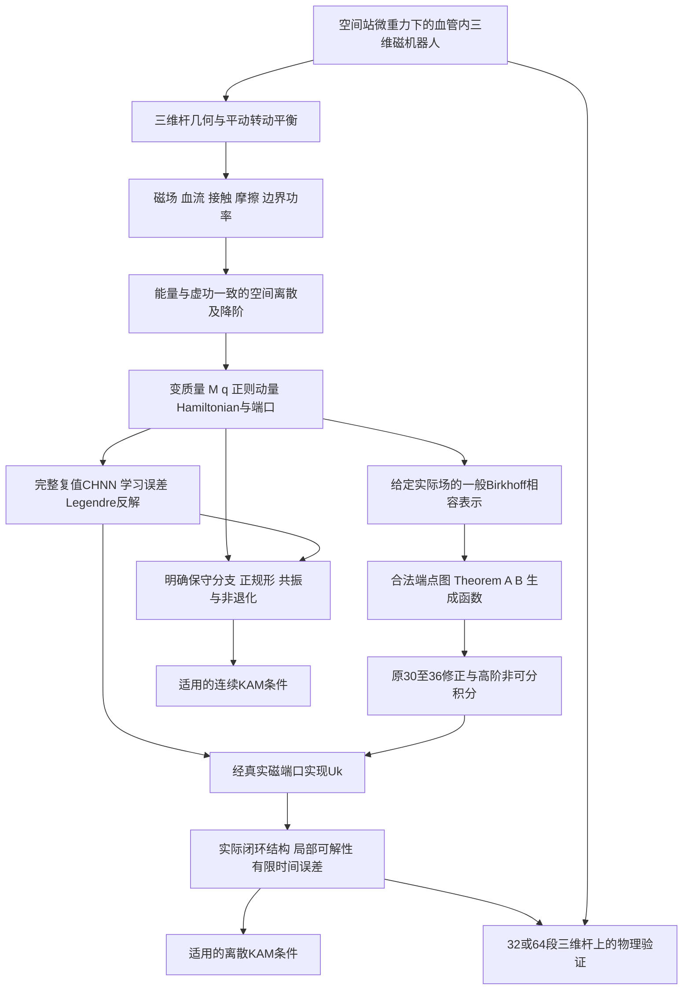

# 以原始 1025 为主线的完整研究路线

审计基线：仓库 `38ee6a7fb8f279fc80be05ee2bd4956817364ffc`。本文件先从原始 DOCX 的正文和原生数学对象重建路线，再对照第一阶段详细审查及第二、第三阶段材料。结论是：**研究目标在材料中仍被保留，但第三阶段目前只实现了这条路线中的局部连接；不能把它称为完整继承后的新论文或最终三维血管机器人理论。**

## 1. 原始材料身份、阅读方法和精确定位

实际文件为仓库根目录 `推理草稿5月1025.docx`，SHA-256 为 `8c62b874caaa6362b0f1c5612ddd6514aa7141454b17ef4cf5688408fe307338`。本轮完整顺序阅读正文 1222 个段落，包括附后的 Theorem A/B 证明；提取并保留 570 个原生 `m:oMath` 对象。没有依据第三阶段的纯文本摘要替代原稿。正文没有图片型公式；`w:oMath` 的 70 个空节点是 Word 格式属性，不是另 70 个 OMML 数学对象。

可复算入口为 `python stage4/audit/program/extract_omml.py`。原始正文 XML 在 `source_omml/original1025_document.xml`；每个数学对象的原始 XML、结构标签和段落归属在 `source_omml/original1025_indexed.json`；保留分式、脚标、矩阵、求和及极限结构的阅读副本在 `source_omml/original1025_reading.txt`。**阅读文件第 N 行就是 `original1025-pNNNN`；`mNNNN` 是数学对象文档顺序，与不稳定的印刷公式号无关。** 渲染只是阅读辅助，原始 XML 是判定分母、转置、脚标和矩阵位置的依据。提取完整不等于已经独立重证原稿援引的所有外部定理。

第一阶段详细报告 `stage3/source_inputs/starter/references/1025_stage1_review.docx` 也按相同方法保存为 `stage1review_*`：2274 段、1343 个数学对象，SHA-256 `482f2f941b0e1dc50bd78ba36c21c9394cd4931f4b9b91fd487d3b93d9afa338`。本轮直接检查其原式对照、三维力学/功率/降阶推导及相应专题证明；其“曾阅读898页文献”的历史自述不是本轮重新阅读898页的证据。

**完整第二阶段融合报告源文件确实存在**：`stage3/source_inputs/starter/stage2/report/stage2_complete.md`，2106 行，包括三维物理、旧 v10 复算、一般 Birkhoff、完整复网络、正质量网络失败和 Metriplectic 十一个章节。不能把“没有编译后的报告附件”写成“没有完整报告”。该文件第46–56行记录的原稿哈希与本轮实际文件一致。第三阶段没有与这些新增程序一一对应的完整新论文；保存在 `stage2/paper/` 和旧整合包中的英中论文是各自历史版本，不能更名为第三阶段完整新稿。

## 2. 必须保持的连续逻辑

原稿不是先选一个方便的二维 Hamiltonian，再寻找机器人解释。其依赖次序应是：

图中的三条不同责任不能互相替代：Birkhoff 表示处理给定场与二形式的相容；结构积分处理离散拉回恒等式；KAM 处理满足解析、非退化和小除数条件的特定保守对象。磁跟踪改善、能量下降或一个精确图匹配恒等式，均不能补上另外两条的假设。

## 3. 十三个环节的原稿依据、有效继承与断点

| 环节 | 原稿精确位置 | 应保留的数学内容与必须修正处 | 实际继承及尚未连接之处 |
|---|---|---|---|
| 1. 微重力血管机器人目标 | p0023–0056：外力、血流、壁接触及微重力；p1081–1091：控制与机器人任务 | 最终对象包含外场、开放环境和三维形变；`f_gravity=0` 只是理想工况，不能代表空间站生理标定。 | 第二阶段报告第5–6章仍保留三维目标；第三阶段 `notes/theory.md:210` 明列未完成项。目标文字未被删除，但本轮 ROM 窗口实验未验证最终场景。 |
| 2. Kirchhoff/Cosserat 几何与平衡 | p0008/m0001；p0014–0020；p0023/m0014；p0059/m0037；p0076–0078/m0047–0049 | 保留 `r,R∈SO(3),ν,κ`、平动与转动惯性；不可同时无条件令伸长率1又写1+ε；扭转刚度为 `GJ_t`。 | `stage2/program/rod3d/` 实现完整杆计算；`learning/rod_rom.py:68` 为不可伸长/不可剪切三维 Kirchhoff 分支。两者职责不同，ROM 不能删除完整杆的伸长、剪切。 |
| 3. Maxwell 磁场与磁能 | p0035/m0021；p0202–0225/m0117–0133 | Maxwell 总力需面积分及一致介质约定；固定偶极的力与矩由同一磁能生成，不能只保留梯度力而丢磁矩。 | ROM 磁能及 `rom_bridge.py:91` 磁端口复用真实几何。局部源外仿射场与完整线圈不是同一模型；完整线圈负结果须保留。 |
| 4. 脉动血流与 Morison | p0040/m0024、p0042；p0094–0100 | `r_tt−V_f` 把加速度减速度，量纲错误；平方阻力必须含投影宽度；移项不能漏流体速度项。Morison 适用域需 Re/Womersley/堵塞等条件。 | 第二阶段报告第5.3、6.4节是规定流场的单向作用；第三阶段 Birkhoff 场使用常对角动量阻尼，并未把真实血流投影接入输运构造。 |
| 5. 壁面、摩擦、微重力边界 | p0049/m0031、p0054；p0025–0026、p0056 | 接触使用实值穿透 `δ=(d0−d)+`；摩擦对相对速度做负功；移动壁、入口/出口、基座和残余加速度必须计入功率。 | 第二阶段有刚性管腔罚接触、平滑摩擦、规定流与合成残余加速度。柔性壁、双向 FSI 和微重力生理标定仍待做；第三阶段未构造其通用 Birkhoff 图。 |
| 6. PDE→FEM/Galerkin→ROM | p0086–0131；弱式 p0115–0126/m0074–0085 | 原(8)消去姿态的四阶梁 PDE 不等于一般三维杆；空间弱式须同时保留旋转虚功与边界项。位形相关基函数的时间导数不能忽略。 | 第一阶段 p0424–0459 给能量一致修正；第二阶段几何 Ritz 直接建立变质量；第三阶段真实调用此 ROM。但尚无完整 Cosserat→ROM 的统一误差估计。 |
| 7. Hamiltonian、耗散、Metriplectic | p0150–0171/m0097–0116；p0246–0306 | `p=M(q)qdot`，`H=½pᵀM⁻¹p+V` 及全部 `∂M⁻¹` 项；`K(q)q` 有势需要可积性。机械能衰减与总能量/熵双退化是不同对象。 | 第一阶段 R1–R5 与 M1–M4、第二阶段第9章给具体候选；第三阶段 `ROMBridge` 保留变质量并复跑候选核验。未将热状态伪称实际已标定机器人。 |
| 8. 完整复值 CHNN 与学习误差 | p0338–0370；p0529–0600；p0643–0789 | 正则尺度化后采用 `(q+ip)/√2`；对应 Wirtinger 系数为 `1/√2`。实 Hamiltonian 不必对 ξ 单独全纯；任意非保守力不能自动塞入虚势。训练应匹配功率与向量场，不能强制受迫机械能恒定。 | 旧 v10 有完整固定解析特征读出；第二阶段另有真正可训练复网络和 SPD 网络，并有失败。第三阶段标量磁势学习只是一项残差基准，尚未继承完整网络训练与复域误差链。 |
| 9. 一般 Birkhoff、Pfaff 与相容 | p0797/m0347；p0804/m0349；p0844–0851；p1113–1177 | `K=(Da)ᵀ−Da`，`Kf=∇B+a_t`，闭性、非退化及时间输运必须同时成立。原 `F1,p=1` 与随 p 的 `F1,t` 不相容。闭形式只在局部/适当拓扑下保证势。 | 一般 Birkhoff 材料及第二阶段保存完整局部输运/Moser/表示误差推导。第三阶段是实际 ROM 上的一阶输运、常对角 Γ 的特例；它是新模型连接，并非完整理论的替代。 |
| 10. Theorem A/B 与原(30)–(36) | A p0862–0879，附证 p1179–1206；B p0881–0888，附证 p1208–1213；各式索引见下节 | 端点匹配、横截性、局部梯度图、规范自由、固定生成变量递推与端点重构不能略去。原(36)必须改矩阵左逆，几何惯性保留。 | 旧整合 `supp_structure.tex`、第二阶段报告第7章有详细材料；第三阶段 `theory.md:185` 压缩为一段前提。中点/Central4 真正接入 ROM，但一般 A/B 的高阶端点递推与通用图重构没有实现。 |
| 11. 控制 Uk 的选取与磁实现 | p1082–1088/m0482–0487 | 原稿比较积分器内部控制、事后状态增量与生成函数控制；这三个层级不可混同。必须经过 `Q_m=G_m(q)u`，有界小控制不等于可达或保结构。 | 第三阶段有阻尼补偿、学习残差、势整形、共点阻尼与受限输入。它对原稿是实质推进；但不可达残差、全线圈差异和反馈链式导数仍限制结构结论。 |
| 12. 控制后结构、精度与收敛 | p1059/m0456；p1073–1088；p1106、p1217–1219 | 分别证明保持哪个二形式、局部唯一更新、原场有限时间误差。近似图误差与场表示误差不能混合；固定窗口模型误差不会随积分步长趋零消失。 | 第二阶段已区分这些误差，第三阶段同 ROM 对比新增了真实模型证据，但场近似平台仍存在。定理中的统一导数/逆矩阵/域界未由有限采样完成认证。 |
| 13. 正规形、连续与离散 KAM | p0435–0520；p1063–1078；p1106–1111 | 极坐标不自动成为真作用角；非共振、twist、解析域、扰动小量及离散步长共振各有责任。耗散或任意小反馈不能套保守 KAM。 | 旧 v10 冻结连续证书应保留原两模态对象；第二阶段发现三维圆截面1:1共振。第三阶段没有新的三维 KAM 证书，亦未恢复旧全部证书输入；这是待证而非失败证明。 |

## 4. 原 Theorem A/B 与(30)–(36)的稳定索引

| 原标签/内容 | 原始位置 | 必须连同阅读的内容 |
|---|---|---|
| Theorem A 陈述 | p0862–0879；横截条件 m0377、PDE m0384、Möbius Jacobian m0390–0391 | 原稿未在陈述处完整写出端点二形式适配；不能只看行列式。 |
| Theorem A 附证 | p1179–1206/m0541–0560 | 末端随时间变、初始端点固定；`D` 的正负约定须统一；生成函数仅差时间常数。p1204 的 `N` 必须可逆断言不成立。 |
| Theorem B 陈述 | p0881–0888/m0393–0399 | 陈述处系数下标偏一位；不可据此删去整条合法解析递推路线。 |
| Theorem B 附证 | p1208–1213/m0561–0565 | **p1213 已写正确的 k+1 递推下标**，应恢复此有效内容，再澄清固定生成坐标的导数。 |
| (30) | p0910/m0400 | `(Q,P)=((q+qhat)/2,−(p+phat)/2)`，差分变量顺序不能互换。 |
| (31) | p0920/m0408 | 逆变换及随后矩阵 p0925/m0414；不能把括号当标量乘法。 |
| (32) | p0931/m0417 | 正确 `wdot=(qhat_dot/2,−phat_dot/2)`，p0932 是另一差分变量。 |
| (33) | p0961/m0427 | 原候选有阻尼时未必是梯度，`o(2)` 必须定量。 |
| (34) | p0963/m0429 | 生成关系须来自合法标量生成函数，代数外观不证明保结构。 |
| (35) | p0986/m0434 | 变质量中点中的动量二次几何项不可删。 |
| (36) 初次 | p1003/m0442 | 由 p0993–1003 的矩阵次序/分式错误修正为完整隐式系统。 |
| (36) 再现 | p1070/m0470；p1220/m0570 | 三个位置为同一研究问题的重复，不是三个独立已证算法。 |

原稿的(9)、(19)、(21)、(36)等重复；(11)仅有后文引用，未发现独立标签(13)、(23)、(29)。本审计不编造缺失编号。后附自伴性与二形式证明也必须保留：p1125 先写 `Ω=dα`，p1154–1156 又真实推得其全指标定义下 `Ω=2dα`；最小修正是统一 `Ω=½ΣKij dzi∧dzj`。这一系数错误不推翻 `d²α=0` 的闭性机制，但会污染未统一的结构匹配常数。

## 5. 继承应怎样恢复，而不恢复错误

第一，恢复完整变分与功率链。三维杆的 SO(3) 虚转角、自然边界、磁能和外端口必须共同导出同一个 `M(q),V(q),G_m(q)`。原(8)的梁推导作为受限几何回归保留；新增三维结果应依赖三维杆变分结构，不能再从原梁近似反向宣称得到一般三维方程。第一阶段 p0343–0459 的界面功率、线圈反电势、DAE 和时变嵌入漂移项，是第三阶段短笔记没有展开的有效内容，值得在完整稿中恢复。

第二，恢复一般 Birkhoff 定理链，再把第三阶段作为例子挂入。需完整保留一般材料中的输运构造、规范变换、Moser 路径条件、端点匹配和原场残差预算；A/B 的端点重构和解析递推不能只保留几个名词。对实际 24 维场，先界定光滑区域与载荷，再记录数值图构造成本、非退化范围、表示误差和端点残差。一阶特殊 Γ 图可继续作为已运行基准，但不能写成任意脉动流、接触和反馈的通用算法。

第三，恢复完整学习支线的不同身份。旧固定解析特征回归、第二阶段可训练复网络、正质量网络和第三阶段标量磁势系数，应分别有架构、输入数据、尺度、权重、训练/验证域、Hessian/Legendre 与误差责任。缺少冻结权重时标为“历史结果保留，本轮无法重训练/证书复算”，不能删除已有方法，也不能把历史数值抄作本轮结果。

第四，原稿中的三个后续问题应保持同一对象：修正(36)比较；真实可达的 `U_k`；实际闭环的结构/收敛/KAM。每次控制策略改变后，必须重新检查实际场，而不能拿未控制模型的二形式或“冻结输入辛子步”替代闭环结论。第三阶段已经向此方向推进，尚需接回血流、接触及高维杆，并给统一误差预算。

第五，旧 v10 的非可分 Central4、确定性学习误差、有限幅值环面、64 平面自由度提升、净空和 S 路径，作为独立冻结基准保留全文证明及不利对照。它们在第二阶段完整报告第4章确有详细继承，但第三阶段没有把这条链完整编入新稿。新三维圆截面杆的共振正规形应单独研究；不能修改频率舍入制造非共振，也不能由线性1:1共振断言所有有限幅值环面不存在。

本文件是路线重建和继承定位。各公式的独立证明审查、源码核验和本轮实际测试结果分别见同目录 `birkhoff_full_audit.md`、`chnn_kam_inheritance.md`、`physical_and_control_audit.md`、`proof_errors_and_corrections.md` 与 `reproduction_and_tests.md`。完整路径与六种继承状态见 `full_inheritance_matrix.csv`，不能用一个“已继承”布尔值概括整条链。
