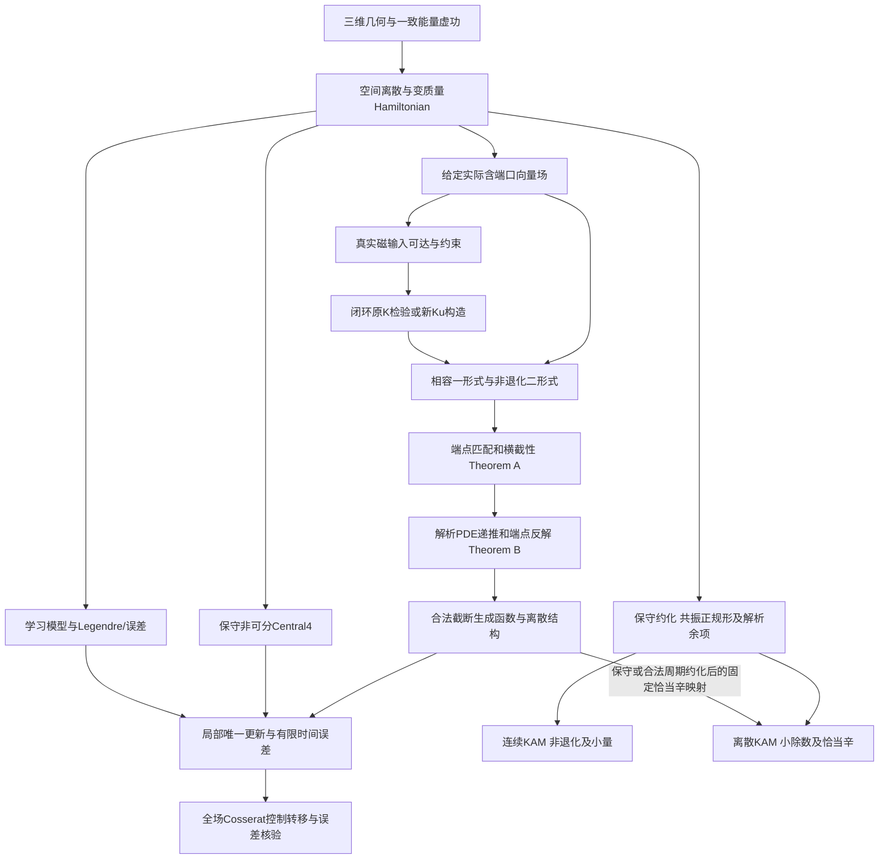

# 完整新论文的章节、证明依赖和补齐工作

当前不存在一篇完整承接第三阶段新结果的正式新论文。本文件是审计后的组织与研究依赖，不是将现有短笔记改名为论文。旧两模态、64 平面自由度与新三维结果分别标明对象；最终对象仍为微重力下血管内三维磁驱柔性介入机器人。

## 1. 正文章节及不可省略的证明

| 章 | 内容及必须保留的推导 | 现有依据 | 必须新增或补齐 |
|---|---|---|---|
| 1 | 任务、物理尺度、微重力边界与研究对象层级 | 原1025、第一阶段审查、stage2第5章 | 实际生理/材料参数来源与有效范围；明确中间计算层 |
| 2 | Cosserat 的 r、SO(3)、应变、平动/转动平衡；伸长剪切与 Kirchhoff 约束 | stage2完整杆与原稿修正 | 统一自然边界、惯性/磁/接触虚功及参数符号 |
| 3 | Maxwell/磁能、Biot–Savart、电流约束、规定流与壁接触、开放端口功率 | 既有完整场和流/接触源码 | 全场磁功率与线圈/基座/流体能量交换；局部仿射有效域及负结果 |
| 4 | FEM/Galerkin、几何 Ritz、变质量正则缩放与 Legendre 变换 | 实际12DOF ROM及第一阶段弱式 | 完整杆与ROM的空间/模态误差和磁力投影误差；血流接触降阶闭合 |
| 5 | 完整复值 CHNN、解析特征基准、SPD网络、学习误差 | 旧完整读出与stage2真复网络 | 公平训练、独立确认、Legendre反解、域内误差；不以单系数实验代替 |
| 6 | 一般 Birkhoff 变分原理、一形式输运、闭性非退化、规范与时间图 | 一般材料和stage2第7章 | 将局部存在证明与实际可计算构造分开，给实际三维场的残差/成本 |
| 7 | 完整 Theorem A/B、端点匹配、横截性、固定生成坐标PDE、递推和反解 | 修正旧v10与stage2；原后附证明有效部分 | 实际ROM上的高阶或分片构造、图过渡条件和失败边界 |
| 8 | 原(30)–(36)逐式修正；中点、合法加权格式、非可分Central4 | 旧完整Central4推导与新24维实测 | 同物理分支/初态/终时的完整比较；一般Birkhoff当前长窗不成功要列出 |
| 9 | Uk的设计、磁可达性、投影残差、势整形、共点反馈及约束 | 原三个控制问题、stage3磁接口 | 全场每步闭环、固定秩/活动集分析、样本斜率与连续电流约束区分 |
| 10 | 实际闭环二形式、局部唯一更新、有限时间误差预算 | 旧收敛分析、stage2误差分层 | 域、Jacobian逆界、控制/图/学习/ROM/求解残差的统一常数 |
| 11 | 保守分支正规形、连续KAM、恰当辛映射与离散KAM | 旧两模态完整独立支线 | 新3D共振正规形/约化、非退化与复解析域、连续及离散小除数 |
| 12 | 旧冻结回归与新三维实验：32/64段、三维末端、血流壁力、功率、时空误差 | stage2历史全场及学习转移、stage3短窗结果 | 新控制在全场Cosserat实测、长时/接触验证；恢复缺失证据后独立复算 |
| 13 | 适用范围、不利结果与最终目标尚缺部分 | 本审计 | 柔性壁、双向FSI、真实微重力标定按证据推进，不能用结论措辞补齐 |

## 2. 定理依赖关系

图中的回路表达“控制改变后重新检查模型”，不是循环论证。证明顺序是先固定一个具体闭环，再构造和检验其结构。未知精确流可用于存在性证明，但不能作为数值方法的免费输入。

## 3. 应原样保留对象身份的历史支线

旧 v10 的完整 CHNN/解析特征、非可分 Central4、学习误差、两模态正规形、冻结连续证书、有限幅值环面、64 平面自由度磁控制和 S 路径，需要独立章或长附录，保留关键推导、域、参数、证明输入及失败对照。它们证明到的对象不能更名为新的 12 DOF 三维系统。旧管坐标的“恰当辛”表述按本审计修正；测度体积转移的有效部分保留。

第二阶段的一般 Birkhoff 高维/Moser 结果及失败、复网络失败、SPD确认协议、完整场和Womersley/杆网格研究也应保留。历史摘要可用于提出复现问题，不能当本轮新测数据。第三阶段的真实ROM连接、四阶积分、磁可达性及全场负结果则作为新增结果。

## 4. 附录应保持数学深度

附录A保留原稿稳定位置到修正公式的逐式表；B给三维弱式、边界功率和正则缩放；C给Birkhoff符号/规范/输运及Moser条件；D完整证明A/B和原(30)–(36)矩阵消元；E保留非可分Central4推导及恰当辛原函数；F给求解残差与多来源误差；G给CHNN架构、归一化、Legendre和失败；H分列旧与新KAM对象；I给线圈单位、磁能梯度和可达性；J给运行命令、缺失资产及历史/新证据身份。

## 5. 可验收的下一步研究，而非文字包装

1. 完整磁力接口：在每次ROM/全杆求值中使用同一全磁能，统一偏置，记录端口秩/力残差/电流及连续约束；不能仅重放已计算的仿射轨迹。
2. 一般图算法：在实际平滑三维载荷上实现更高阶输运或数值图及端点重构，用原场独立参考验证，不让图匹配机器精度掩盖场误差；记录失败域。
3. 恢复完整学习比较：补齐冻结文件才能复证旧训练；新训练可独立进行，但须相同数据/预算/种子/确认协议，传播动力学误差及磁不可达残差。
4. 全杆验证：复用既有32/64段代码和旧历史控制，加入新控制、血流与接触，统一物理时间和时空网格；不要把12DOF的求积加密称作全杆网格收敛。
5. 理论边界：对光滑固定分支给局部可解性和显式误差常数；三维共振KAM作为独立高难度定理项目，无证书时明确待证。

前三项可并行，后两项分别依赖可验证的动力学/控制和解析模型。只有这些依赖闭合后，才适合将新增材料写为完整的三维研究论文。
